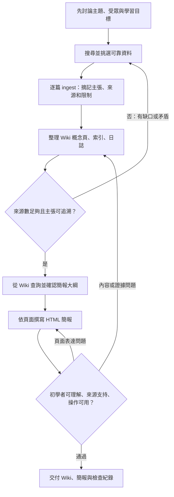

# Loop / graph、執行紀錄與反思

## Graph

## 哪些步驟重複？

- **資料 ingest / Wiki 整理**：資料不足、術語不一致或新來源與舊說法不同時，回到搜尋、閱讀和修訂頁面。
- **簡報產生 / 檢查**：某頁難懂、缺來源或混淆概念時，只回到相關 Wiki 頁補強，再重寫受影響的簡報頁。
- **lint**：新增來源或大幅修改後再跑一次，檢查來源標記、索引連結、矛盾和過時資訊。

## 為什麼這樣設計？

分開「原始來源」和「整理後的 Wiki」，讓內容可以回查；先把 Wiki 整理好，再做投影片，避免簡報變成沒有知識庫支撐的即興回答。將查核放在 Wiki 綜整和簡報完成兩處，可以早點抓出術語或證據問題，也能檢查最終教學是否清楚。這沿用 Karpathy 提出的 raw / wiki / schema 分層、ingest、query 和 lint 概念，但本次資料量很小，採用人工查核而非自動化程式。[S01]

## 本次實際執行與檢查紀錄（2026-11-12）

| 檢查項目 | 本次結果 | 記錄 |
|---|---|---|
| 資料 ingest | 通過 | 5 篇來源，含作者原始構想、工程文章、論文、官方 SDK 文件、官方協定介紹。 |
| 來源可回查 | 通過 | 每份摘記有直接 URL；Wiki 使用 `[S01]` 至 `[S05]` 對應來源。 |
| 簡報內容來源 | 通過 | 投影片引用來源編號，末頁列出完整連結。 |
| 術語界線 | 修正後通過 | 發現容易把 Workflow / Agent 寫成唯一正式二分法；改成「Anthropic 使用的架構區分」，並註明用語可能不同。 |
| MCP 說法 | 通過 | 界定為外部系統連接標準；加入「不保證資料正確或操作安全」。 |
| 可瀏覽簡報 | 已製作 | 單檔 HTML，提供方向鍵、前後按鈕、頁數和小螢幕排版；交付前以閱讀 HTML 與流程檢視方式查核。 |

本紀錄是這次製作的人工查核結果，不代表有自動化評測、效能測試或多輪使用者測試。

## 反思

- **這次最容易出錯的節點**：Wiki 綜整時的術語界線。各來源使用 Agent 一詞的範圍不完全相同，若把其中一個架構觀點寫成普遍共識，簡報會過度簡化。
- **檢查往前移到哪裡**：移到來源閱讀與 Wiki 整理的交界。現在先在來源摘記中寫下作者的定義和限制，再編簡報大綱；不用等投影片完成才檢查概念是否一致。
- **有沒有修改 workflow / graph？為什麼？** 有。在「整理 Wiki」後新增來源數與主張可追溯的 gate；若術語缺證或來源衝突，先回資料搜尋和 ingest。原因是只在簡報尾端檢查，會讓上游的概念誤差一路複製到多頁投影片。

## 繳交資訊（自行填寫）

標題格式：`學校 學號 系級 姓名 AI Agents 入門`

- 學校：＿＿＿＿
- 學號：＿＿＿＿
- 系級：＿＿＿＿
- 姓名：＿＿＿＿
