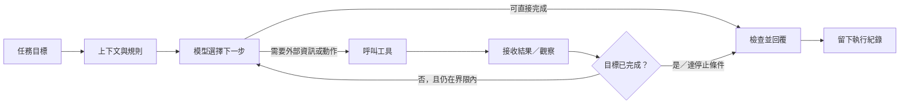

# Agent 的運作循環與工作流程

## 一個入門模型

**接收目標 → 準備上下文 → 模型選擇回答或提出工具動作 → 工具執行 → 取得觀察 → 判斷完成或繼續 → 回答／停止**。這是簡化的教學圖，不是每個框架都採用相同實作。[S03][S04]

## Workflow 和 Agent 的差異

Anthropic 使用一個有用的架構區分：Workflow 由程式安排固定路徑；Agent 則讓模型動態控制步驟和工具使用。實際產品可能混合兩者，日常說法也不一定完全一致。選擇時要看任務是否需要動態處理，以及額外成本是否值得。[S02]

## 選簡單合適的流程

- 步驟穩定、答案格式固定：先試固定 Workflow。
- 需要依不同結果選擇工具或下一步：可試有明確界限的 Agent loop。
- 需要多個專業角色：先確認能否用單一 Agent 加工具解決，再考慮分工；交接和協調也會增加設計負擔。[S02][S04]

## 本作業製作 Wiki／簡報的 graph

本作業的製作 graph 與 AI Agent 執行 loop 相似，但它是由人安排的研究流程，不是能自行操作外部系統的自主 Agent：

**討論問題與讀者 → 搜尋來源 → ingest 摘記 → 整理 Wiki → 查 Wiki 編簡報 → 檢查 → 交付**。

有缺口或無來源支持時回到「搜尋來源 / ingest」；簡報說法不清楚時回 Wiki 修正後重做受影響頁面。詳細圖在 [作業流程與反思](../docs/workflow-and-reflection.md)。
